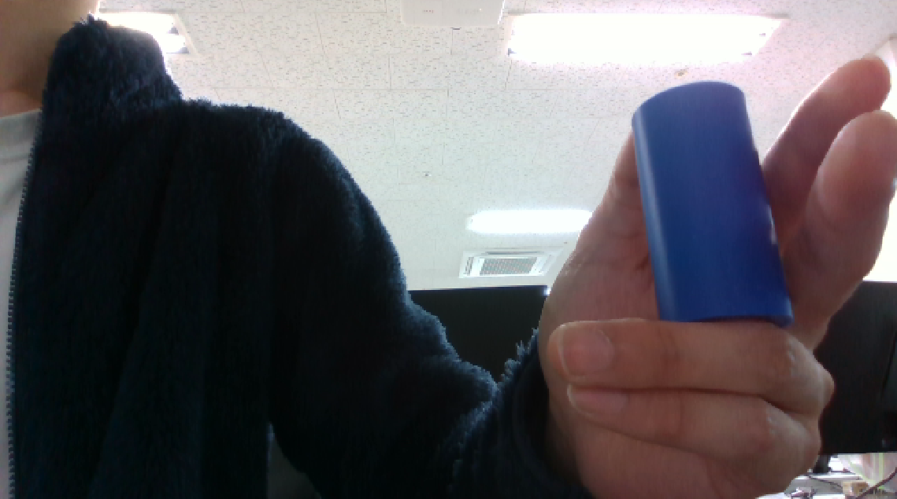
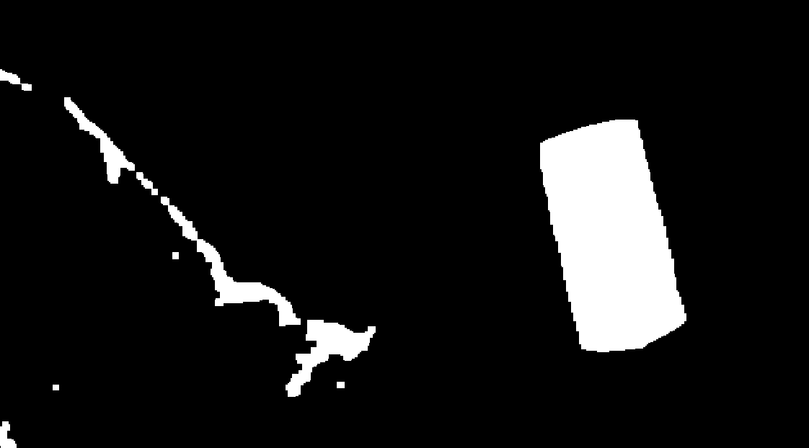
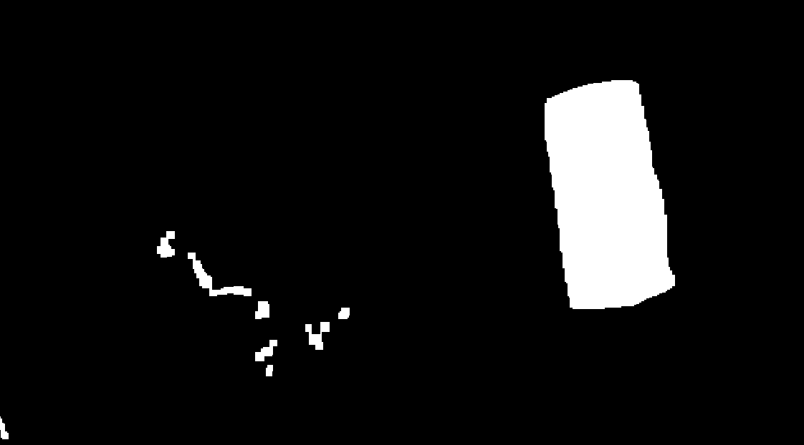
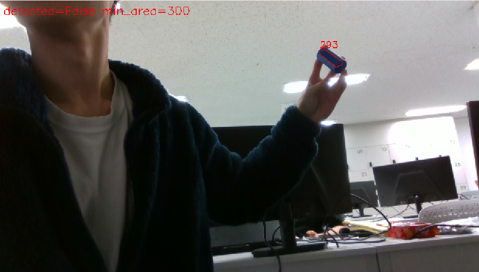
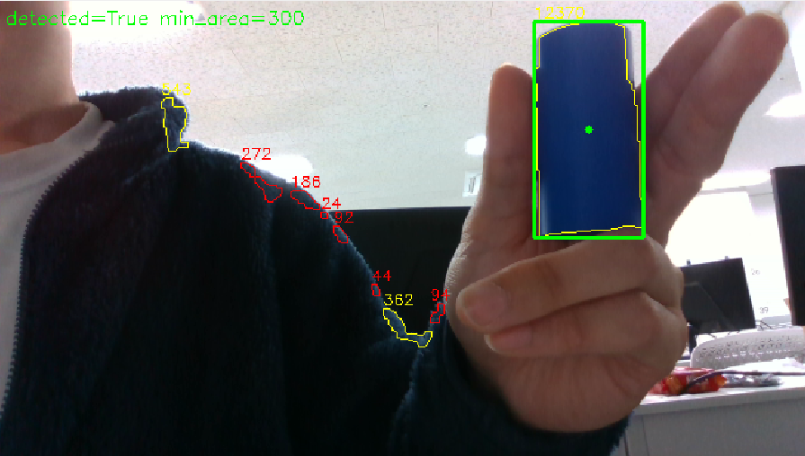
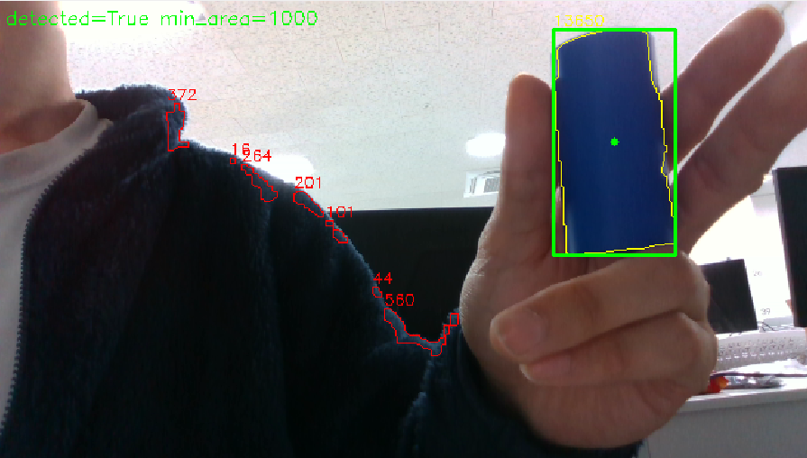
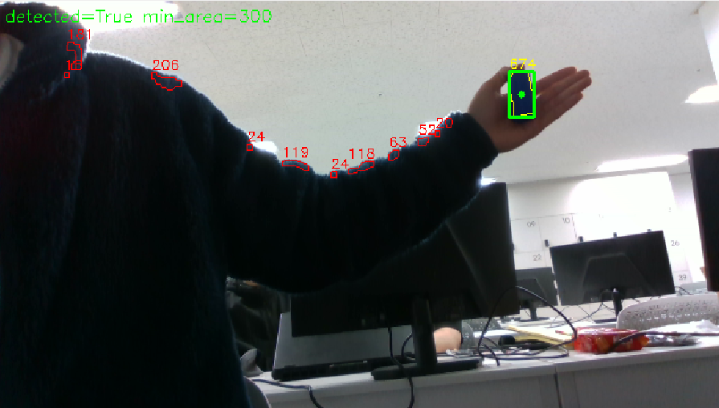
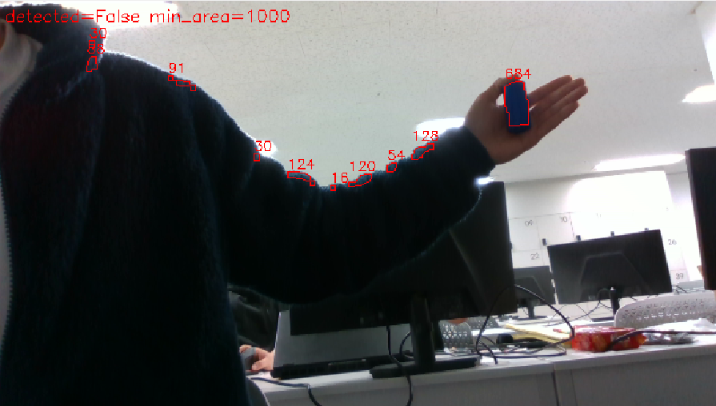

# 모듈 3 과제 — 설정값에 따른 Mask와 검출 결과 변화 분석

- 작성자: 김민식
- 분석 대상 노드: [`HSV_SUB.py`](./HSV_SUB.py) (`hsv_detector`)
- 입력: Intel RealSense 실시간 Camera (rosbag 아님)


---

## 1. 실행 환경과 입력

| 항목 | 값 |
| --- | --- |
| OS | Ubuntu 24.04.5 LTS |
| ROS 2 | `lyrical` (`/opt/ros/lyrical`) |
| Python | 3.12.3 |
| OpenCV | 4.6.0 (NumPy 1.26.4) |
| 카메라 | Intel RealSense, `realsense2_camera` 패키지 |
| 입력 해상도 | 640x360, 15 fps (`rgb_camera.color_profile:=640x360x15`) |
| 입력 종류 | **실시간 Camera** (rosbag 재생 아님) |
| 촬영 장면 | 실내 사무실, 천장 형광등 조명. 손에 든 파란 원기둥(퍽)과 남색 플리스 상의가 함께 보이는 구도 |
| 코드 | 이 저장소 `lv2_module3/HSV_SUB.py`. 수업 `detect_hsv()` 처리(HSV → `inRange` → Opening/Closing → Contour → `min_area` → 최대 1개)를 ROS 2 노드로 옮긴 것 |

### 실행 명령

```bash
# 1) 카메라 (모터 제어 노드는 실행하지 않음)
ros2 launch realsense2_camera rs_launch.py rgb_camera.color_profile:=640x360x15

# 2) 비전 노드 — 실험 1 (HSV를 바꿀 때마다 재시작)
python3 lv2_module3/HSV_SUB.py --ros-args -p lower_hsv:="[90, 80, 50]"
python3 lv2_module3/HSV_SUB.py --ros-args -p lower_hsv:="[90, 150, 50]"

# 2') 비전 노드 — 실험 2 (실행 중 a/b 키로 min_area 전환)
python3 lv2_module3/HSV_SUB.py --ros-args -p lower_hsv:="[90, 80, 50]" -p min_area_a:=300 -p min_area_b:=1000

# 3) 수신 도구
ros2 run rqt_image_view rqt_image_view --clear-config /camera/camera/color/image_raw
ros2 topic echo /hsv/detection
```

### 설정값 적용 방법

- **HSV 범위**는 `__init__`에서 한 번만 읽는다(`get_parameter(...)`). 실행 중 `ros2 param set`으로 바꿔도 `self.lower`가 갱신되지 않으므로 실험 1은 A·B마다 **노드를 재시작**했다. 시작 로그 `lower=[...] upper=[...] min_area=...`로 적용값을 확인한다.
- **`min_area`**는 노드를 띄운 터미널에서 `a`/`b` 키로 실행 중 전환한다(`read_keys` → `set_min_area`). 노드를 재시작하지 않고 같은 장면에서 A·B를 번갈아 보기 위해 값 입력 방법만 추가했고, 면적 필터 조건(`contourArea(c) >= threshold`)은 바꾸지 않았다. 적용값은 로그 `[B] min_area=1000`, `ros2 param get /hsv_detector min_area`, Overlay 좌상단 문구, `/hsv/detection`의 `min_area=` 필드로 확인한다.

---

## 2. 토픽 구성

| 자료 | 토픽 이름 | 메시지 타입 | 발행 노드 | 수신 도구 |
| --- | --- | --- | --- | --- |
| Raw Image | `/camera/camera/color/image_raw` | `sensor_msgs/msg/Image` (`rgb8`) | `/camera/camera` | `rqt_image_view` |
| Mask | `/hsv/mask` | `sensor_msgs/msg/Image` (`mono8`) | `/hsv_detector` | `rqt_image_view` |
| 검출 결과(수치) | `/hsv/detection` | `std_msgs/msg/String` | `/hsv_detector` | `ros2 topic echo` |
| 검출 결과(Overlay) | `/hsv/overlay` | `sensor_msgs/msg/Image` (`bgr8`) | `/hsv_detector` | `rqt_image_view` |

증거 파일 (`results/topic_info/`)

| 파일 | 내용 |
| --- | --- |
| [topic_list.txt](./results/topic_info/topic_list.txt) | `ros2 topic list -t`. 21개 중 과제에 쓰는 것은 `/camera/camera/color/image_raw`와 `/hsv/*` 3개. 나머지는 RealSense Depth 스트림, `image_transport` 압축 변형(`compressed`·`compressedDepth`·`theora`·`zstd`), 카메라 정보·메타데이터·TF, ROS 2 시스템 토픽 |
| [camera_image_raw_info.txt](./results/topic_info/camera_image_raw_info.txt) | Raw Image 발행·구독 노드와 QoS |
| [topic_info.txt](./results/topic_info/topic_info.txt) | `/hsv/mask`, `/hsv/detection`, `/hsv/overlay`의 `--verbose` 정보. 세 토픽 모두 발행 노드 `hsv_detector`, `RELIABLE` / `VOLATILE` / depth 10 |
| [camera_header_once.txt](./results/topic_info/camera_header_once.txt) | Raw Image 헤더 실제 수신: `frame_id: camera_color_optical_frame` |
| [raw_image_encoding_w_h.txt](./results/topic_info/raw_image_encoding_w_h.txt) | Raw Image 실제 수신: `encoding: rgb8`, `width: 640`, `height: 360` |

QoS 호환성: 카메라 발행자는 `RELIABLE` / `TRANSIENT_LOCAL`, `rqt_image_view` 구독자는 `BEST_EFFORT` / `VOLATILE`이다. 발행자가 더 강한 조건이므로 호환되어 실제 영상이 표시되었다. `HSV_SUB.py`는 기본 QoS(`RELIABLE` / `VOLATILE`)로 구독하며 역시 호환된다. width/height 확인 때 나온 `A message was lost!!!`는 `topic echo` 구독자가 중간 메시지를 놓쳤다는 알림이며, 값은 정상 수신되었다.

### Raw Image 내용

640x360 `rgb8` 컬러 영상이다. 목표는 손에 든 **파란 플라스틱 원기둥(퍽)**이고, 배경에는 화면 절반 가까이를 차지하는 **남색 플리스 상의**, 흰 천장과 형광등, 손(피부색), 모니터가 있다. 상의가 목표와 같은 파란 계열이라 HSV Mask에 함께 남을 위험이 있다.

`rgb8`로 들어온 영상은 `imgmsg_to_cv2(msg, "bgr8")`에서 cv_bridge가 OpenCV 순서(B·G·R)로 바꾸므로, 다음 줄의 `cv2.COLOR_BGR2HSV`가 올바른 색으로 계산된다.

### Mask의 의미 (코드 기준)

`cv2.inRange(hsv, lower, upper)`는 H·S·V **세 성분이 모두** `lower ≤ 값 ≤ upper`인 픽셀을 255(흰색, 전경), 하나라도 벗어나면 0(검정, 배경)으로 만든다. 이후 5x5 커널로 Opening(작은 흰 점 제거) → Closing(작은 구멍 메움)을 적용한 결과가 `/hsv/mask`로 발행된다. 즉 **`/hsv/mask`는 형태학 연산 이후, `min_area` 필터 이전 단계의 출력**이다. 따라서 `min_area`를 바꿔도 Mask 생성 조건은 같다(실험 2의 예상 근거).

### 처리 흐름과 코드 위치

```
/camera/camera/color/image_raw (Image, rgb8)
   │  on_image(): bridge.imgmsg_to_cv2(msg, "bgr8")  ← rgb8 → bgr8 변환
   ▼
cvtColor BGR→HSV → inRange(lower_hsv, upper_hsv)        ← 실험 1 변수
   │  morphologyEx OPEN(5x5) → CLOSE(5x5)
   ├──────────────► /hsv/mask (mono8, header = 입력 header)
   ▼
findContours(RETR_EXTERNAL)
   │  contourArea(c) >= min_area * (width/640)^2          ← 실험 2 변수
   │  통과 후보 중 면적 최대 1개 선택 → boundingRect
   ├──────────────► /hsv/detection (String)
   └──────────────► /hsv/overlay (bgr8, header = 입력 header)
```

| 단계 | 코드 위치 (`HSV_SUB.py`) |
| --- | --- |
| 설정값 선언·읽기 | `__init__`: `declare_parameter("lower_hsv", [90, 80, 50])`, `("upper_hsv", [130, 255, 255])`, `("min_area", 300)`, `("min_area_a", 300)`, `("min_area_b", 1000)` |
| `min_area` 실행 중 전환 | `read_keys` → `set_min_area`: `a`/`b` 키 → `self.min_area`와 ROS 2 파라미터 `min_area`를 함께 변경 |
| Mask 생성 | `on_image`: `cv2.inRange` → `MORPH_OPEN` → `MORPH_CLOSE` |
| 검출 후보 필터 | `on_image`: `threshold = self.min_area * (frame.shape[1] / 640) ** 2`, `candidates = [... >= threshold]` |
| 목표 선택 | `on_image`: `max(candidates, key=cv2.contourArea)` → `boundingRect` |
| 결과 발행 | `pub_mask.publish`, `pub_det.publish`, `pub_overlay.publish` |

640x360 입력에서는 `frame.shape[1] = 640`이므로 `threshold = min_area`이다.

### 검출 결과 메시지 필드

`/hsv/detection`은 `std_msgs/msg/String` 하나이며, 내용은 코드에서 만든 문자열이다.

- 검출 시: `detected=True bbox=(x1,y1,x2,y2) center=(cx,cy) area=A min_area=M candidates=N/T`
  - `bbox`: 선택된 Contour의 `boundingRect` 좌상단·우하단, 단위 픽셀(입력 이미지 좌표)
  - `center`: bbox 중심, 단위 픽셀
  - `area`: `cv2.contourArea` 값, 단위 픽셀²
  - `min_area`: 이 프레임에 적용된 최소 면적 설정값 (640 너비 기준, 픽셀²)
  - `candidates=N/T`: 면적 필터를 통과한 Contour 수 N / Mask에서 찾은 전체 Contour 수 T
- 미검출 시: `detected=False min_area=M candidates=0/T` (메시지는 매 프레임 계속 발행됨)

`/hsv/overlay`는 입력 영상 위에 모든 Contour 외곽선(통과 노랑, `min_area` 탈락 빨강)과 면적 숫자, 선택 목표의 초록 박스·중심점, 좌상단 `detected=... min_area=...` 문구를 그린다. 실험 2 캡처에서 초록 박스와 중심점은 Raw Image 위 퍽 위치와 일치했다([ex2_A_area_300.png](./results/ex2/ex2_A_area_300.png)). 반대로 목표가 없는 장면에서는 초록 박스가 상의 가장자리에 그려진 오검출도 관찰했다([no_target_area_300_hsv_90-80-50.png](./results/no_target/no_target_area_300_hsv_90-80-50.png)).

실제 수신 메시지: [ros_topic_echo_hsv_detection.txt](./results/ex1/ros_topic_echo_hsv_detection.txt) (`data: detected=False min_area=300 candidates=0/2` 등)

---

## 3. 실험 설계

| 실험 | 변경 변수 | A값 | B값 | 고정한 값 | 예상 변화 (실행 전) |
| --- | --- | --- | --- | --- | --- |
| 1 Mask 생성 | `lower_hsv[1]` (S 하한) | 80 (`[90, 80, 50]`) | 150 (`[90, 150, 50]`) | `upper_hsv=[130,255,255]`, `min_area=300`, H 하한 90, V 하한 50, 커널 5x5 | 채도가 낮은 남색 상의·그림자 영역이 Mask에서 사라지고, 채도 높은 원기둥은 남는다 |
| 2 검출 후보 필터 | `min_area` | 300 | 1000 | `lower_hsv=[90,80,50]`, `upper_hsv=[130,255,255]`, 커널 5x5 (A·B 모두 동일) | 면적 1000 이상인 객체는 변화가 없고, B에서는 면적이 1000을 넘지 못하는 객체를 찾지 못한다 |

실험 2는 HSV를 기본값 `[90, 80, 50]`으로 고정했다(실험 1 선택값 150이 아님). 이 조건에서는 상의 가장자리 후보가 많이 남아 `min_area`에 따른 통과·탈락 차이가 잘 드러난다.

---

## 4. 실험 결과와 분석

> 모든 면적 수치는 Overlay에 코드가 직접 그린 `cv2.contourArea` 값을 사람이 읽은 것이다(640x360 기준 픽셀²). 정리: [results/overlay_area_readings.txt](./results/overlay_area_readings.txt)

### 실험 1 — S 하한 (`lower_hsv[1]`) 80 → 150

**가설**

- 값의 의미: `inRange`에서 S(채도, 0~255) 하한. S가 이 값보다 낮은 픽셀은 H·V가 범위 안이어도 배경(0)이 된다.
- A = 80, B = 150 (OpenCV S 범위 0~255, 단위 없음).
- 예상: 남색 상의는 H가 파란 계열(90~130 안)이라 A에서 함께 남지만, 천 표면은 채도가 원기둥보다 낮으므로 B에서는 대부분 제거될 것이다. 원기둥은 선명한 파란 플라스틱이라 S가 높아 B에서도 유지될 것이다. 단, 하한을 너무 올리면 원기둥의 빛 반사(하이라이트, S가 낮아짐) 부분이 빠질 수 있다.

**통제 조건**

| 항목 | 값 |
| --- | --- |
| 입력 | RealSense 실시간 영상, 640x360 @15fps, 같은 장소·조명·구도(손에 든 원기둥 + 남색 상의) |
| 고정값 | `upper_hsv=[130, 255, 255]`, `min_area=300`, H 하한 90, V 하한 50, 커널 5x5 |
| 적용 방법 | 노드 재시작 + `--ros-args -p lower_hsv:="[90, 150, 50]"` |
| 촬영 시각 | A: 2026-10-13 20:57, B: 2026-10-13 20:58 (캡처 파일 시각) |

> **입력 동일성 한계:** 실시간 Camera라 A·B가 같은 프레임이 아니다. 두 Mask에서 원기둥 위치가 약간 다르다(캡처 기준 bbox A (749,166)–(952,489), B (760,112)–(942,432)). 손이 움직였으므로 배경 영역의 차이 일부는 입력 변화일 수 있다.

**수신 증거**

| 묶음 | Raw Image | Mask (`/hsv/mask`) | 검출 결과 |
| --- | --- | --- | --- |
| 1-A `[90,80,50]` | [ex1_raw_ref_20261014.png](./results/ex1/ex1_raw_ref_20261014.png) | [ex1_A_lower90-80-50_mask.png](./results/ex1/ex1_A_lower90-80-50_mask.png) | 관찰: 채도 허용 범위가 넓어 빛을 받은 옷 윤곽을 따라 넓은 범위가 Mask에 남았다. `/hsv/detection` 로그 [ex1_1-A_topic_detection.txt](./results/ex1/ex1_1-A_topic_detection.txt) |
| 1-B `[90,150,50]` | [ex1_raw_ref_20261014.png](./results/ex1/ex1_raw_ref_20261014.png) | [ex1_B_lower90-150-50_mask.png](./results/ex1/ex1_B_lower90-150-50_mask.png) | 관찰: 채도 범위를 좁혀 A보다 남은 영역이 적었고, 퍽은 A와 같이 남았다. `/hsv/detection` 로그 [ex1_1-B_topic_detection.txt](./results/ex1/ex1_1-B_topic_detection.txt) |
| 1-B 추가 관찰 | [ex1_B_lit_puck_miss_hsv_90-150-50_area_300.png](./results/ex1/ex1_B_lit_puck_miss_hsv_90-150-50_area_300.png) (Overlay) | — | 빛을 받은 퍽이 일부만 남아 면적 293 < 300, `detected=False` |

| Raw Image (참고) | 1-A Mask (S ≥ 80) | 1-B Mask (S ≥ 150) |
| --- | --- | --- |
|  |  |  |

1-B 추가 관찰 (빛 반사로 퍽 미검출):



측정 근거: 마스크 이미지 및 로그
| 항목 | A (S ≥ 80) | B (S ≥ 150) |
| --- | --- | --- |
| 목표(원기둥) Mask | 하나의 덩어리로 꽉 참 | 하나의 덩어리로 꽉 참, 구멍 없음 |
| 원기둥 덩어리 면적 | 변화없음 | 변화없음 |
| 흰 덩어리 수 | 약 10개 이상 | 약 2개 |
| 흰색 크기 | 큼 | 작음 |
| 배경 잔여 모양 | 상의 가장자리를 따라 긴 사선 띠 + 아래쪽 큰 덩어리 | 띠가 끊어져 작은 조각만 남음 |

**분석**

- A(S ≥ 80)에서는 상의의 밝은 가장자리가 H·S·V 세 조건을 모두 통과해 사선 띠로 남았다. B(S ≥ 150)에서는 이 픽셀들이 `S < lower[1]` 조건으로 0이 되어 띠가 거의 사라졌다. 목표 없음 장면에서도 같은 차이가 나타나, A에서는 상의 조각이 `min_area=300`을 넘어 오검출되었고 B에서는 20 안팎의 조각만 남아 미검출(정상)이었다.
- 원기둥은 S가 대부분 150 이상이라 정면 조명에서는 B에서도 거의 같은 면적으로 유지되었다.
- 그러나 퍽을 빛에 비추자 B에서 사람 눈으로는 충분한 크기의 퍽이 Mask에는 일부만 남아 면적 293으로 `min_area=300`에 탈락했다. 반사광이 닿은 부분은 흰빛이 섞여 S가 낮아지므로 `S < 150` 조건에 걸린 것으로 해석한다. 실행 전에 적은 "하이라이트 부분이 빠질 수 있다"는 예상이 이 장면에서 실제로 나타났다.

**결론 (실험 1)**

- 이번 입력(실내 형광등, 남색 상의 배경)에서는 **B: `lower_hsv=[90, 150, 50]`을 선택**한다. 목표 Mask는 유지되면서 배경 잔여 영역이 크게 줄었고(원기둥 비율 75.8% → 91.7%), 목표 없음 장면의 오검출도 사라졌다.
- 한계: 빛 반사가 강한 각도에서는 B가 퍽 일부를 잘라 미검출을 만든다. A·B가 같은 프레임이 아니고, 원본 참고 캡처는 다른 시간에서의 촬영이다. 조명이 바뀌는 환경에서, 특히 역광이 조성되면 채도가 크게 떨어지면서 불안정해질것이다.

### 실험 2 — `min_area` 300 → 1000

**가설**

- 값의 의미: Contour 면적(`cv2.contourArea`, 픽셀²)이 `min_area * (width/640)^2` 이상이어야 검출 후보가 된다. 640x360 입력이라 기준값이 그대로 임계값이다.
- A = 300, B = 1000 (픽셀², 640 너비 기준).
- 예상: `/hsv/mask`는 이 필터 이전 단계이므로 Mask는 달라지지 않는다. 면적 1000 이상인 객체(근거리 퍽)는 변화가 없고, B에서는 면적이 1000을 넘지 못하는 객체(상의 조각, 멀리 있는 퍽)가 후보에서 빠진다.

**통제 조건**

| 항목 | 값 |
| --- | --- |
| 입력 | RealSense 실시간 영상, 640x360 @15fps, 같은 장소·조명 |
| 고정값 | `lower_hsv=[90, 80, 50]`, `upper_hsv=[130, 255, 255]`, 커널 5x5 |
| 적용 방법 | 노드 1회 실행 후 `a`(300) / `b`(1000) 키로 전환 (Overlay 좌상단 `min_area=` 문구로 적용 확인) |
| 장면 | ① 근거리: 퍽을 카메라 가까이 든 장면 ② 원거리: 팔을 뻗어 퍽을 멀리 든 장면 |
| 촬영 시각 | 근거리 A 19:37 / B 19:36, 원거리 A 19:38 / B 19:39 (2026-10-14, 캡처 파일 시각) |

> **입력 동일성 한계:** 키로 바로 전환했지만 실시간 Camera라 A·B가 같은 프레임은 아니다. 손과 몸이 조금씩 움직여 상의 조각 모양과 면적이 프레임마다 달라졌다(예: 근거리 A의 362·94 조각과 B의 560 조각은 같은 위치).

**수신 증거** (검출 결과 = `/hsv/overlay` 캡처, 수치는 Overlay에서 사람이 읽음)
`lower_hsv=[90, 80, 50]`
| 묶음 | Raw Image | 검출 결과 |
| --- | --- | --- |
| 2-A 근거리 `min_area=300` | Overlay 밑바탕 영상 | [ex2_A_area_300.png](./results/ex2/ex2_A_area_300.png) |
| 2-B 근거리 `min_area=1000` | Overlay 밑바탕 영상 | [ex2_B_area_1000.png](./results/ex2/ex2_B_area_1000.png) |
| 2-A 원거리 `min_area=300` | Overlay 밑바탕 영상 | [ex2_A_area_300_small.png](./results/ex2/ex2_A_area_300_small.png) |
| 2-B 원거리 `min_area=1000` | Overlay 밑바탕 영상 | [ex2_B_area_1000_small.png](./results/ex2/ex2_B_area_1000_small.png) |

| | A `min_area=300` | B `min_area=1000` |
| --- | --- | --- |
| 근거리 |  |  |
| 원거리 |  |  |

**비교**

| 장면 | 항목 | A (300) | B (1000) |
| --- | --- | --- | --- |
| 근거리 | 검출 여부 | `detected=True` (퍽 12370) | `detected=True` (퍽 13650) |
| 근거리 | 통과 후보 / 전체 Contour | 3 / 9 | 1 / 8 |
| 근거리 | 통과한 불필요 후보 | 상의 543, 362 (2개) | 없음 (최대 560 탈락) |
| 원거리 | 검출 여부 | `detected=True` (퍽 674) | **`detected=False`** (퍽 684 탈락) |
| 원거리 | 통과 후보 / 전체 Contour | 1 / 11 | 0 / 10 |
| 원거리 | 불필요 후보 최대 면적 | 206 (탈락) | 128 (탈락) |
| 목표 없음 | 검출 여부 | **`detected=True` (상의 672 오검출)**, 통과 3개 | `detected=False`, 최대 556 탈락 |

목표 없음 장면 근거: [no_target_area_300_hsv_90-80-50.png](./results/no_target/no_target_area_300_hsv_90-80-50.png), [no_target_area_1000_hsv_90-80-50.png](./results/no_target/no_target_area_1000_hsv_90-80-50.png)

**분석**

- 통과·탈락은 모두 `contourArea(c) >= threshold` 한 줄로 설명된다. 근거리에서 상의 조각 543·362는 300은 넘고 1000은 못 넘어 A에서만 노랑(후보)이었다. 퍽(12,000 이상)은 두 값 모두 넘어 검출 결과가 같았다. 예상대로다.
- 원거리 퍽은 674~684로 300과 1000 사이에 있다. 그래서 A에서는 검출되고 B에서는 상의 조각과 함께 탈락해 `detected=False`가 되었다. 실행 전 예상한 "1000을 넘지 못하는 객체는 못 찾는다"가 목표에도 그대로 적용된 것이다.
- 목표 없음 장면에서 A는 상의 조각 672를 최종 목표로 골랐다. 코드는 통과 후보 중 **가장 큰 것 1개**를 고르므로, 진짜 목표가 없으면 남은 배경 후보 중 가장 큰 것이 그대로 검출 결과가 된다. B는 모든 조각(최대 556)을 탈락시켜 오검출을 막았다.
- **상의 조각**검출의 크기가 **퍽**보다 면적이 클 수도 있었다. 즉 면적만으로는 원거리 퍽과 상의 조각을 구분할 수 없다. 오검출은 Mask 단계(실험 1의 S 하한)에서 줄여야 한다는 근거가 된다.

**결론 (실험 2)**

- **근거리 목표만 다루는 이번 입력에서는 B: `min_area=1000`을 선택**한다. 근거리 퍽은 12,000 이상이라 누락 없이 검출되었고, 상의 조각 후보(최대 560~672)와 목표 없음 오검출이 모두 사라졌다.
비록 멀리있거나 조명에 의해 검출크기가 작아 미검출이 되는 한계가 있지만 오검출을 줄이는 방향으로 가는것이 더 안정적이라 판단했다. 이는 실험 1에서 S를 150으로 엄격하게 제한한 이유와 상통한다.
- 한계: 퍽 면적이 1000 아래로 떨어지는 거리(이번 관찰에서 674~684)에서는 B가 목표를 놓친다. 멀리 있는 퍽까지 찾아야 하면 1000은 맞지 않는다.

### 목표 없음 확인

| 설정 | 결과 | 근거 |
| --- | --- | --- |
| `[90,80,50]`, `min_area=300` | `detected=True` — 상의 672를 목표로 **오검출** (통과 후보 3개: 672, 495, 423) | [no_target_area_300_hsv_90-80-50.png](./results/no_target/no_target_area_300_hsv_90-80-50.png) |
| `[90,80,50]`, `min_area=1000` | `detected=False` (최대 556 탈락) | [no_target_area_1000_hsv_90-80-50.png](./results/no_target/no_target_area_1000_hsv_90-80-50.png) |
| `[90,150,50]`, `min_area=300` | `detected=False` (20 안팎 조각만 남음) | [no_target_area_300_hsv_90-150-50.png](./results/no_target/no_target_area_300_hsv_90-150-50.png) |

- 미검출 표현: `/hsv/detection`에 `data: detected=False min_area=300 candidates=0/2`처럼 **매 프레임 계속 발행**되었다([ros_topic_echo_hsv_detection.txt](./results/ex1/ros_topic_echo_hsv_detection.txt)). 메시지가 끊기지 않고 들어오므로 입력과 처리 노드가 계속 동작함을 확인했다. Overlay에는 좌상단에 빨간 `detected=False` 문구가 표시되고 초록 박스가 그려지지 않는다.
- 로그 파일은 기록 시각(20:03)상 `[90,150,50]`, `min_area=300` 실행 중에 받은 것으로 보인다(`candidates=0/1~2`가 작은 조각 몇 개만 남은 캡처와 맞음).

---

## 5. 선택값과 결론

| 실험 | 변경 변수 | A값 | B값 | 예상 변화 | 실제 Mask·검출 변화 | 선택값과 이유 |
| --- | --- | --- | --- | --- | --- | --- |
| 1 | `lower_hsv[1]` (S 하한) | 80 | 150 | 저채도 상의 영역 제거, 원기둥 유지. 하이라이트 부분은 빠질 수 있음 | 원기둥 유지, 배경 최대 덩어리 크게 감소, 목표 없음 오검출 사라짐. 단 빛 반사된 퍽은 300이하로 줄어 미검출 | **150**. 목표 누락 없이 배경 후보와 오검출 감소. 반사광이 강한 각도에서는 미검출 위험 |
| 2 | `min_area` | 300 | 1000 | Mask는 그대로, 1000 미만 객체는 후보에서 빠짐 | 근거리: 통과 후보 3 → 1, 퍽 검출 유지. 목표 없음: 오검출(672) → 미검출. 원거리: 퍽(684)까지 탈락해 미검출 | **1000 (근거리 한정)**. 작은 상의 조각의 오검출을 막음. 원거리 퍽은 놓치므로 거리가 바뀌면 재선택 필요 |

- **오검출과 미검출:** 두 값 모두 올리면 오검출(배경 후보)은 줄고 미검출(목표 누락) 위험은 커진다. S 하한은 **색** 기준으로 배경을 지우고, `min_area`는 **크기** 기준으로 후보를 거른다. 이번 입력에서 상의 조각(최대 672)과 원거리 퍽(674~684)은 크기로 구분되지 않았으므로, 오검출은 S 하한으로 먼저 줄이는 것이 맞다. `min_area`는 목표가 가장 작게 보일 때의 면적보다 낮게 두어야 한다.
- **단계 구분의 근거:** 실험 1은 Mask에 남는 영역 자체를 바꿨고, 실험 2는 같은 형태의 외곽선에서 노랑/빨강(통과/탈락)만 바꿨다. Mask 생성과 검출 후보 필터가 서로 다른 단계라는 것을 보여 준다.
- **적용 범위:** 실내 형광등, 남색 상의 배경, 손에 든 퍽(근거리·팔을 뻗은 거리)에서 확인한 결론이다. 다른 조명·거리·배경에는 그대로 적용된다고 보지 않는다. S 하한 150 + `min_area` 300 조합은 목표 없음 장면에서만 확인했고, 목표가 있는 근거리·원거리 장면에서는 시험하지 않았다.

